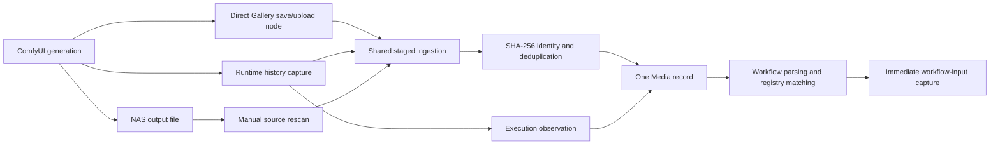

# ComfyUI Runtime Integration Cycle

**Status:** Proposed

**Date:** 2026-08-27

**Scope:** Main backend/API/web plus the existing optional ComfyUI bridge package

## Purpose

Comfy Gallery already handles historical media safely: immutable bytes are the
media identity, embedded workflow metadata is preserved as ground truth, and a
live ComfyUI process is optional. The missing piece is a better cycle while the
current ComfyUI process is online.

ComfyUI's execution history is useful but volatile. A restart loses prior prompt
history even when output files remain on disk. The proposed integration therefore
captures useful live evidence promptly without making ComfyUI a runtime dependency
or pretending that the current installation explains unrelated historical media.

Primary-source API findings are recorded in
[ComfyUI runtime API capabilities](../research/comfyui-runtime-api-capabilities.md).

## Architectural boundary

The integration MUST preserve the accepted boundaries in
[ADR-0005](../decisions/0005-offline-node-registry.md),
[ADR-0010](../decisions/0010-no-comfyui-instance-entities.md), and
[ADR-0012](../decisions/0012-capture-workflow-input-media.md):

- Do not create a persistent, user-managed ComfyUI-instance entity or assign
  historical media to an assumed producer installation.
- Treat the configured ComfyUI URL and optional user header as operational
  connector configuration.
- Keep media identity internal and based on exact bytes, never filenames,
  prompt IDs, or ComfyUI paths.
- Preserve embedded metadata as the strongest workflow ground truth.
- Store live history as additional provenance; it never silently overwrites
  embedded evidence.
- Keep browsing, review, analytics, and already captured inputs usable while
  ComfyUI is offline.

The proposed **ComfyUI runtime connector** is consequently a replaceable adapter
and worker, not a new domain owner.

## What the live API is useful for

| Capability | Use in Comfy Gallery | Reliability boundary |
| --- | --- | --- |
| `/system_stats` and `/features` | Health, version, and capability negotiation | Current process only |
| `/object_info` and `/object_info/{class}` | Node-registry snapshots and current compatibility checks | Installed nodes may differ from historical workflows |
| `/models` and `/models/{folder}` | Current model availability and registry enrichment | Paths are not historical model identity |
| `/api/jobs` and `/api/jobs/{id}` | Prefer a paginated retained-execution index, then fetch details only for unseen jobs | Newer API over the same volatile in-memory state |
| `/history` and `/history/{prompt_id}` | Fallback capture of completed API prompts, visual workflows, status, and output locators | In-memory, bounded, clearable, and lost on restart |
| `/queue` and `/prompt` GET | Current activity and queue-remaining indication | Operational status, not durable provenance |
| `/ws` | Low-latency status wake-up and reconnect detection | Per-execution events may target the submitting client ID |
| `/view` | Immediately fetch current input/output bytes by safe locator | Current mutable storage, not a historical version store |
| `/v2/userdata` and legacy `/userdata` | Optional browsing of workflows explicitly saved in ComfyUI | Saved workflows are not evidence for a generated file |
| `/upload/image` | Explicitly restore captured image inputs before reopening a workflow | Mutates ComfyUI input storage and requires a user action |
| `POST /prompt` | Possible future controlled rerun | Executes GPU work and is deferred from the first integration slice |

Queue mutation, interruption, history deletion, memory unloading, and arbitrary
filesystem paths are outside this integration. Comfy Gallery observes ComfyUI; it
does not administer the running generation queue.

## Live validation snapshot

The user's configured production URL was probed read-only from both the Mac and
the Xanta NAS on 2026-08-27:

- ComfyUI `0.34.0`, required frontend `1.49.6`.
- NAS-to-ComfyUI requests succeeded at `192.168.50.88:8188`.
- `/object_info` returned 4,464 definitions in approximately 11.1 MB.
- `/models` returned 64 model-folder names.
- `/userdata?dir=workflows&recurse=true` returned 140 saved workflows.
- Five history items occupied approximately 387 KB. One completed video
  execution contained a 34-node API prompt, `extra_pnginfo.workflow`, execution
  status, and an output locator with `filename`, `subfolder`, and `type`.
- The newer `/api/jobs?limit=5` index occupied approximately 3.1 KB and exposed
  pagination plus retained job IDs; one unseen job detail was approximately 77 KB.
  The connector can therefore avoid repeatedly downloading known workflow payloads.
- `/features` reported `assets: false`; the experimental asset API returned its
  disabled response and cannot be part of the required path.
- An independently registered WebSocket client received global `status` and
  extension events, but no guarantee of the browser client's execution events.
- History responses supplied no `ETag` or `Last-Modified` validator, so repeatedly
  downloading full history is not an efficient change detector.

These observations validate the design against the real environment without
turning that exact response shape into a universal contract.

## Three converging ingestion lanes

No one live mechanism is sufficiently durable. Three lanes should converge on the
same existing ingestion service:

### Lane 1: direct output-node upload

This remains the strongest online path. A ComfyUI output node saves the exact final
file with metadata and sends those exact bytes to the existing authenticated machine
import endpoint. It succeeds even if ComfyUI restarts immediately afterward.

The node SHOULD continue returning its Gallery upload batch/item result in the
ComfyUI execution output when practical. The Gallery does not require this lane for
every workflow; it is the reliable opt-in path for important generations and videos
whose containers often lack embedded workflow metadata.

### Lane 2: runtime history capture

The connector captures completed history items while they still exist. It extracts
safe output descriptors, fetches each current output through `/view`, stages the
bytes, and passes them through ordinary ingestion. Exact-byte duplicates link to the
existing media record rather than creating a second record.

This lane fills gaps when a workflow used a normal `SaveImage`, VHS video output, or
another compatible output node instead of the Gallery node. It also records the
execution prompt/workflow before a ComfyUI restart removes it.

### Lane 3: NAS source rescan

The existing source inventory remains the durable recovery path for files that were
created while the connector or ComfyUI API was unavailable. It can recover the media
bytes and their embedded metadata, but it cannot reconstruct a lost in-memory history
record. This limitation must be visible rather than guessed around.

## Runtime history capture algorithm

### Discovery

1. An explicit **Capture retained executions** command performs a paginated,
   bounded catch-up. Prefer the smaller `/api/jobs` index and fetch detail only for
   unseen job IDs; fall back to paginated `/history` on older servers. Later phases
   may keep the connector continuously enabled.
2. Persist an observation for each previously unseen prompt ID within the current
   operational connector scope. ComfyUI prompt IDs are treated as external
   idempotency keys, not media IDs.
3. Process only terminal history entries. Successful completed entries are eligible
   for output import; failed entries may retain diagnostic status but do not create
   media without an output.
4. Discover output locators by value shape, not only by keys such as `images` or
   `gifs`: a candidate must contain bounded strings for `filename`, `subfolder`, and
   `type`.
5. Import `type=output` by default. Skip `temp` previews and input echoes unless a
   future explicit option says otherwise.
6. Ignore and never open history-provided absolute fields such as `fullpath`.
   Construct `/view` requests only from validated `filename`, `subfolder`, and
   `type` fields.

### Fetch, identity, and linking

1. Fetch without preview/channel transformations, redirects, or credentials in the
   URL.
2. Stream to the established staging area under a configurable byte limit and
   timeout.
3. Sniff/probe the response, calculate SHA-256, and invoke the same media-ingestion
   service used by browser uploads, machine clients, and scans.
4. Link the execution output to the resulting media ID whether ingestion created a
   new record or found an exact duplicate.
5. Keep one output-use row for each prompt, output node, ordinal, and locator
   fingerprint. One prompt may produce several media; one exact media may have more
   than one execution observation.
6. Mark each output independently as imported, linked duplicate, skipped, missing,
   retryable failure, or terminal failure. One bad custom-node output must not lose
   the other outputs from the same prompt.

### Workflow evidence

History commonly contains both the executed API prompt and a visual workflow under
`extra_data.extra_pnginfo`. Store a bounded immutable execution-evidence artifact
with its own SHA-256 and normalized fields.

Evidence precedence is:

1. Embedded workflow metadata from the immutable media bytes.
2. Exact workflow/prompt sidecar supplied by the Gallery output node while saving
   the same bytes.
3. A completed history entry linked by fetching and hashing that entry's exact output
   locator.
4. Filename or path similarity, which is never sufficient to attach workflow
   evidence by itself.

When embedded and live evidence coexist, compare them and retain both. Embedded
ground truth remains current; material mismatch produces a visible
`workflow_evidence_conflict` warning. When the immutable output has no embedded
workflow, exact-hash-linked history evidence may supply a workflow snapshot with an
explicit `comfyui_history` carrier and lower evidence rank.

After a media/output link is committed, ordinary semantic extraction and immediate
workflow-input capture run. This timing is valuable because `/view` still has the
best chance of resolving the exact input references used moments earlier.

## Efficient continuous watching

The first slice SHOULD be a manual durable catch-up job. Once validated across the
golden output corpus, continuous watching can use a hybrid strategy:

- Hold a WebSocket connection only as a wake-up/reconnect signal. Do not require it
  to deliver every execution event from other client IDs.
- React to global queue/status changes by fetching the jobs index or a small recent
  history window.
- Run a slower paginated jobs/history safety catch-up after reconnect and
  periodically while online.
- Persist seen prompt IDs and per-output terminal state so repeated pages are
  idempotent.
- Use one connector lease and one sequential output transfer on the J4125 NAS.
- Back off with jitter while ComfyUI is unavailable. Offline state is expected, not
  an application failure.

Polling full history every few seconds is explicitly rejected: history entries carry
large prompt/workflow payloads and provide no observed conditional-response
validator.

## Restart and outage behavior

- **CG restarts, ComfyUI remains online:** resume incomplete execution outputs and
  catch up currently available history.
- **ComfyUI restarts:** reconnect, capability-probe the new process, and capture its
  new history. Previously uncaptured history is irrecoverable; a NAS rescan still
  recovers files.
- **Output file is renamed after capture:** managed bytes and the media link remain
  valid.
- **Output locator returns different bytes:** SHA-256 creates/links the bytes actually
  fetched. Do not attach earlier workflow evidence unless it came from the same
  completed history locator fetch; flag suspicious repeated-locator changes.
- **Direct node and history race:** both imports converge by SHA-256 and the execution
  observation attaches to that single media.
- **ComfyUI is offline:** library/review/analysis continue normally; connector status
  becomes offline and retries later.

## Proposed persistent records

### ComfyUI execution observation

- Internal UUIDv7.
- Opaque operational connector-scope fingerprint plus external prompt ID, with a
  composite uniqueness constraint. The fingerprint scopes idempotency but is not a
  user-facing instance identity or media provenance claim.
- Captured/created/completed timestamps.
- Terminal execution status and bounded status messages.
- API prompt and visual workflow evidence hashes.
- Immutable compressed evidence artifact path, byte count, and format version.
- Optional nearest anonymous node-schema snapshot ID.
- Capture state and structured error fields.

Do not expose or use ComfyUI `client_id`, absolute paths, host details, or user
storage layout as media identity.

### ComfyUI execution output

- Observation ID, output node ID, ordinal, and locator fingerprint.
- Validated filename/subfolder/type evidence.
- State, attempts, error code/message, and last attempt time.
- Fetched SHA-256 and byte count.
- Linked Comfy Gallery media ID when resolved.

### Connector status

Reachability, current version, queue remaining, last check, last successful capture,
and next retry are operational projections. They may live in Redis plus job/run
history and do not become a persistent ComfyUI-instance entity.

## Proposed API and UI

### API

- `GET /api/v1/integrations/comfyui/status`
  - configured/reachable, current version/features, watcher state, queue remaining,
    last capture, and aggregate unresolved counts;
  - never returns secrets or an unrestricted upstream URL.
- `POST /api/v1/integrations/comfyui/execution-captures`
  - queues one idempotent bounded catch-up job;
  - options include retained-execution limit, import missing outputs, and
    completed-only;
  - a concurrent active capture returns that durable run instead of creating another.
- `GET /api/v1/integrations/comfyui/execution-captures/:id`
  - progress and counts for executions seen, outputs imported/linked/skipped/failed.
- `POST /api/v1/integrations/comfyui/outputs/:id/retry`
  - retries a non-terminal output while retaining prior attempts.
- A later explicit connector-settings command may enable continuous watching.

These routes orchestrate the connector. They do not replace the existing generic
machine upload, registry sync, media, workflow, or job endpoints.

### Web UI

Add a **ComfyUI connection** section to Operations or Registries rather than an
instance-management page:

- Connected/offline and version/capability summary.
- Current queue activity without prompt contents.
- Last node/model sync and last retained-execution capture.
- **Capture retained executions**, **Sync node registry**, **Sync model registry**,
  and **Retry missing outputs** actions.
- Capture-run progress and per-output actionable errors.
- A later **Watch new completions** toggle with clear LAN bandwidth/storage wording.

Media detail may show a compact provenance row such as “Captured from a live ComfyUI
execution” and any workflow-evidence conflict. The prompt ID belongs in diagnostics,
not the primary media header.

## Reopening media in ComfyUI

The reverse direction should deepen the existing workflow-tab bridge:

1. Compare referenced node classes with the current `/object_info` contract.
2. Compare current checkpoint/LoRA references with current model-folder inventory.
3. Show missing/ambiguous items before opening, without rewriting the stored workflow.
4. If a captured image input is missing from current ComfyUI storage, offer an
   explicit **Restore image inputs and open** action.
5. Upload those managed image bytes to ComfyUI, use the server-returned locator, and
   patch only an ephemeral workflow copy sent to the ComfyUI tab. Captured video
   inputs require a future feature-detected asset upload, shared-filesystem mapping,
   or purpose-built ComfyUI endpoint; the legacy image upload route is not assumed
   to support them.
6. Preserve the original workflow and original input locator in Comfy Gallery.

Automatic `POST /prompt` execution is deferred. Opening a validated workflow in the
ComfyUI UI keeps queueing, model substitutions, and expensive GPU work under the
user's direct control.

## Security and limits

- The connector URL remains administrator-controlled configuration and is never
  accepted as an arbitrary request URL from a browser client.
- Refuse cross-origin redirects and validate every upstream response size/type.
- Never trust `fullpath`, output extension, MIME header, workflow HTML, or custom-node
  fields as a local path or executable content.
- Preserve prompts exactly as requested by product requirements, but return raw
  execution evidence only through explicit authenticated detail endpoints.
- Do not send Gallery bearer tokens to ComfyUI. ComfyUI-to-Gallery custom nodes keep
  their Gallery token in process configuration, not workflow widget values.
- Input restoration and future prompt submission are external writes and require
  explicit user actions.

## Delivery phases

### Phase 1: manual retained-execution catch-up

- Capability probe and status projection.
- Durable bounded capture run.
- Generic safe output-descriptor extraction.
- `/view` staging, exact deduplication, execution/output records, and retries.
- Workflow evidence precedence and input-capture follow-up.
- Operations UI and real image/video golden-corpus validation.

### Phase 2: continuous completion watcher

- WebSocket wake-up plus periodic safety catch-up.
- Connector lease, backoff, restart recovery, and watch toggle.
- Alerting for unresolved outputs without making ComfyUI availability an app-health
  failure.

### Phase 3: compatibility-assisted reopen

- Per-media current node/model preflight.
- Explicit captured-input restoration.
- Ephemeral workflow patch and existing tab-bridge handoff.

### Deferred

- Automatic queue submission through `POST /prompt`.
- Mirroring ComfyUI's saved workflow library into Gallery.
- Queue deletion, interruption, memory management, or ComfyUI administration.
- Claiming provenance for historical files using only names or directories.

## Phase 1 acceptance criteria

- Capturing the same retained executions twice creates no duplicate media or
  execution outputs.
- A history output already imported by the direct node or NAS scan links to the same
  media by SHA-256.
- One prompt producing multiple images/videos links every valid output independently.
- VHS-style `gifs` descriptors work without treating the key name as the media type.
- `temp`, unsafe, oversized, redirected, missing, and malformed outputs are skipped or
  failed with stable codes and do not block other outputs.
- Embedded workflow evidence is never overwritten by history evidence.
- A video without embedded metadata can use exact-hash-linked completed history as an
  explicitly lower-ranked workflow carrier.
- Restarting Comfy Gallery resumes incomplete outputs; restarting ComfyUI clearly
  reports the unrecoverable history gap while NAS rescan remains functional.
- The feature remains usable with ComfyUI offline and does not change library health.
- Capture runs remain sequential and bounded on the J4125 NAS.
