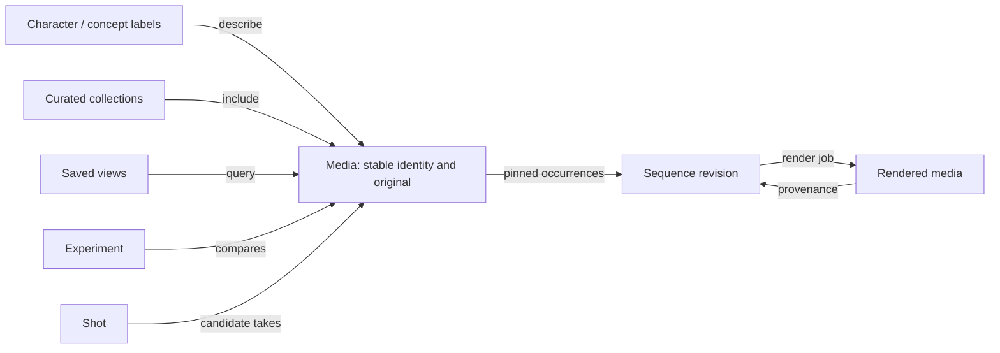

# Media organization, experiments, and sequences

**Status:** Proposed for discussion; not an accepted architecture decision.

**Date:** 2026-09-08

**Scope:** Main full-stack product and shared backend concepts. Native client implementation is a separate follow-up.

**User priority:** Find and organize related media first; compare ComfyUI tests and assemble shots afterward.

## Recommendation

Make the existing library navigable by creative intent: characters, concepts, and curated collections. Add experiment and sequence workspaces when their distinct behaviors are needed. Keep each media record and its original bytes stable while adding relationships around it.

One image or video can depict a character, illustrate a concept, belong to several collections, be an experiment result, and serve as a shot take. A mandatory folder tree cannot express those overlapping uses comfortably.

The immediate opportunity is to finish and improve existing organization tools. Automatic discovery should suggest useful relationships, while explicit user organization remains authoritative.

## What the repository already supports

These findings come from repository inspection, not a production database or media-content audit. The 3,500+ item count is user-reported; similarity quality and actual query latency remain unmeasured.

| Existing capability | Evidence | Design implication |
| --- | --- | --- |
| UUID media identity, immutable originals, exact SHA-256 deduplication | `Media`, `MediaAsset`; ADR-0002 | Add relationships without moving or merging originals. |
| Collections and tags with many-to-many membership | `MediaCollection`, `CollectionItem`, `Tag`, `MediaTag` in the core database models | Reuse them for everyday organization. |
| Collection/tag creation, membership addition, and whole-object deletion | Evaluation routes | Complete rename, individual membership removal, and undo workflows. |
| Collection and tag filters in review scopes; collection selection for slideshows | `MediaFilterRequest`, `_filtered_media_query`, slideshow endpoint | Bring organization into ordinary browsing consistently. |
| Main gallery listing lacks collection/tag parameters and passes `collection_id=None` | `list_media` in media routes | This is a concrete first implementation gap. |
| Saved filters, favorites, reversible Trash, versioned evaluations | Evaluation schemas/routes and core models | Keep these meanings; avoid parallel scoring and deletion systems. |
| Raw workflows, generic values, semantic observations, model identities/slots | Workflow and registry models | Build comparisons from existing evidence. |
| Model comparison groups | `ComparisonGroupMember.artifact_id` | These group model artifacts; they are not media experiments. |
| Slideshow playback | Slideshow page and media route | Reuse playback behavior, but add durable authored order for sequences. |
| Captured workflow input assets/references | Workflow input models | Provide evidence for input/output relationships where available. |

Primary code locations:

- [Database models](../../packages/py/core/src/comfy_gallery_core/db/models.py)
- [Media routes](../../apps/api/src/comfy_gallery_api/routes/media.py)
- [Evaluation and organization routes](../../apps/api/src/comfy_gallery_api/routes/evaluations.py)
- [Review filter schemas](../../apps/api/src/comfy_gallery_api/evaluation_schemas.py)
- [Keyword filtering](../../apps/api/src/comfy_gallery_api/media_filters.py)
- [Library page](../../apps/web/src/pages/library-page.tsx)
- [Slideshow page](../../apps/web/src/pages/slideshow-page.tsx)

## Proposed vocabulary

These terms describe the proposal and do not yet amend the accepted glossary.

| Term | Meaning | Example |
| --- | --- | --- |
| Subject label | A reusable typed label describing content, such as a character or concept | Character: Mira; Concept: Rainy city |
| Collection | A manually curated set assembled for a purpose | Neon-city references; September shortlist |
| Saved view | A named live query, presented using the existing saved-filter mechanism | Mira videos that are favorites |
| Experiment | A question, a selected population of results, comparison settings, and recorded conclusions | Which checkpoint and LoRA weight suit this portrait? |
| Shot | One intended piece of a scene | Close-up before the door opens |
| Take | One media record considered as a candidate for a shot | Three generated alternatives for the close-up |
| Sequence | An authored ordering of media occurrences, including trims or image durations | Opening scene, edit 2 |
| Render | A durable attempt to produce a video from one immutable sequence revision | MP4 rendered from opening-scene revision 2 |
| Related stack | An optional, reversible presentation of alternative outputs behind a representative cover | Twelve alternatives for one intended image |

“Media variant” retains its accepted meaning: an alternate file representation attached to one logical media. Separate generations, experiment results, and different shot takes remain distinct media. A rendered sequence combines content into a new work and is not a variant of its first shot.

## 1. Find and organize related media

### First user experience

Keep one Library with browsable sections for **All media**, **Collections**, **Characters**, **Concepts**, and **Saved views**. Open a character or collection into the familiar gallery, retaining sort, filters, and Previous/Next context. These are navigation choices within the Library, not five new top-level applications.

Example flow:

1. Search for a known positive-prompt phrase or model reference.
2. Select matching items across pages and label them `Character: Mira` and `Concept: Rainy city`.
3. Put a smaller curated selection in `Neon-city references`.
4. Choose a representative cover and pin the character page.
5. Save `Mira + video + favorite` as a live view.
6. On later imports, review suggested labels and continue using the same pages.

Use group cards with a cover, name, item count, and recent additions. Inside a group, let the user expand all media or display curated alternative stacks later. Preserve a visible All media path.

A media record may appear on several character/concept pages. The library total counts distinct media; per-group counts can overlap. Selecting several groups resolves to distinct media IDs before any bulk operation.

### Extend tags without making annotation burdensome

Extend existing `Tag` with a kind, optional description, representative media, and aliases. Start with `general`, `character`, and `concept`; add location/style only if they prove useful. Existing tags become `general` without name changes.

Character pages can hold reference examples and notes about expected appearance. A LoRA name is evidence about how media was generated, not proof that a character appears in it. One character can be generated by several models; one model can produce several characters.

Keep tag IDs stable through rename. Initially preserve current global tag-name uniqueness to avoid a migration solely for naming; aliases are alternate lookup text, never alternate identity. Tag merge should preview affected membership, preserve an operation record, and leave old links resolvable. A later change to uniqueness by kind needs a deliberate compatibility migration.

For collections, add covers, a useful detail page, rename/description editing, member removal, and optional local picks. A collection can already represent a project. Introduce a separate Project concept only when several experiments or sequences need shared project metadata and lifecycle.

### Make bulk actions safe and quick

- Keyboard and range selection, plus an explicit distinction between **this page** and **all matching results**.
- Batch add/remove labels and collection membership with an immediate summary and undo.
- Freeze the selected IDs for an operation; imports arriving afterward must not silently join it.
- Undo reverses only membership changes made by that operation, retaining pre-existing membership and respecting later conflicting edits.
- Removing a collection or label changes organization only; it does not delete media.
- Show membership in media detail, where a label can be added or removed without returning to the grid.
- Display recoverable per-item failures for large batches, and make retry idempotent.

Do not make users evaluate ten criteria just to organize something. Favorites stay a quick global preference; collection picks and preferred takes express context-specific decisions.

### Saved views and an organization inbox

Use the existing saved-filter model for live populations. Useful presets include:

- Recently imported and not yet organized.
- No character or concept label.
- Favorite videos for a particular character.
- Media with unresolved grouping suggestions.
- Later: experiment results awaiting a conclusion or shots without a chosen take.

“Organized” must not require every item to have a character. Provide a separate dismissible organization-inbox marker, such as `organized_at`, so the user can intentionally leave an item unlabeled. This marker is independent of evaluation progress and Trash.

Saved views change as the library changes. Review sessions, bulk operations, analysis runs, and sequence revisions instead capture their selected population at a point in time. Name this difference clearly in the interface.

### Assistive discovery

Deliver discovery in increasing order of uncertainty:

1. Explicit labels or collection context supplied during upload/import.
2. User-defined rules, such as a specific source subdirectory suggesting a collection.
3. Existing prompt/model/input evidence suggesting related candidates.
4. Optional visual similarity search and clustering after measuring a local sample.

Suggestions must explain their reason: “same captured input,” “matching positive-prompt phrase,” or “visually similar.” Show suggested and confirmed membership separately. Accept, reject, split, and undo must be available. Remember rejected suggestions using their subject/media/reason version so unchanged suggestions do not reappear after every scan.

Do not infer narrative order from filename or import time. Do not infer a positive character label from a negative-prompt match. Similarity should help recover media with weak metadata, but similar costumes or backgrounds are not reliable character identity. Videos need representative frame sampling; one poster can miss their content.

Optional automatic rules require an explicit rule opt-in, a dry-run count, and tracked membership provenance. Manual removals must survive reapplication unless the user resets the override. Ordinary metadata and visual suggestions remain reviewable by default.

For the first release, grouped browsing by existing labels/collections is enough. If curated stacks are added, give each a defined browsing scope and at most one stack membership per media within that scope. Other collection/label membership remains unrestricted. This avoids competing collapsed cards in one grid and does not change identity or Trash status.

## 2. Understand ComfyUI experiments

An experiment should answer a named question and preserve what the user learned. Creating one from a selection should work with historical media immediately, without a live ComfyUI connection.

Example: compare three checkpoint choices and four LoRA strengths for the same intended portrait. Show a matrix with checkpoint rows and strength columns. Each cell contains actual media, replicate counts, and missing-value indicators. The matrix must not imply all combinations were generated.

Useful interactions:

- Pin one result as a baseline and highlight changed configuration fields.
- Select any extracted node input as a comparison axis, including values that have no semantic mapping.
- Compare two images at matched zoom; compare videos with explicit time alignment and one active audio source.
- Hide configuration during judging using the existing review workflow.
- Mark selected results within this experiment, add notes, and record a conclusion.
- Reopen or export known workflow evidence, with input/model availability clearly distinguished from reproducibility.

Baseline and configuration comparison are established experiment-tracking patterns; W&B documents baseline runs and comparison deltas. This proposal adapts that interaction to media and the existing local evaluation system. [W&B run comparison](https://docs.wandb.ai/models/runs/compare-runs)

### Comparison data and identity

Add a versioned configuration projection derived from existing workflow evidence. Preserve:

- Checkpoint identity and usage slot, including ordered multi-checkpoint pipelines.
- Ordered LoRA usages, enabled state, model/CLIP strengths where present, and unresolved raw references.
- Prompts, seeds, sampler/scheduler, steps, CFG, denoise, size, duration/FPS where known.
- Captured input hashes, known node definitions, and additional generic node values.
- Evidence references, extractor/profile versions, missing fields, and ambiguity.

Do not compress a workflow to one checkpoint and one LoRA. Do not treat missing values as zero or assume missing means an inactive node.

Use three distinct matching concepts:

| Match | Meaning | Use |
| --- | --- | --- |
| Evidence fingerprint | Identical preserved evidence | Trace extraction and reprocessing |
| Known configuration signature | Equal compared values under a named projection version | Find matching known settings |
| Experiment grouping signature | Equal selected controls after explicitly excluding chosen axes | Arrange matrix cells and candidate groups |

Seed and prompt remain included unless the user explicitly chooses otherwise. A settings signature is not proof of identical runtime behavior. Missing custom-node semantics or model hashes must remain visible.

Ignore graph layout for semantic comparison. Align nodes by known roles and graph structure; use IDs only within a known snapshot. If graph changes make alignment ambiguous, show added/removed or unresolved nodes instead of declaring a single-field difference. Preserve the raw-value diff alongside the semantic explanation.

One execution can produce several media; repeated executions can produce exactly the same bytes. Store experiment media membership separately from execution observations. Reuse the proposed [runtime integration cycle](comfyui-runtime-integration-cycle.md) if it is implemented, but do not assume it already exists. Historical files without execution evidence remain imported results with unknown run grouping. An upload batch or matching timestamp does not prove one execution.

### Evaluation and conclusions

Reuse existing media scores and immutable analysis snapshots. Store experiment-specific selections and notes separately. A configuration comparison can be saved with its exact media membership, configuration-projection versions, and chosen axes, so later extraction changes do not silently rewrite its conclusion.

Historical experiments remain observational under [ADR-0008](../decisions/0008-observational-analytics.md). Show co-varying settings and sample coverage. Several output files from one known execution must not be presented as independent trials. Optional controlled comparisons are a future explicit mode; they do not replace current analysis defaults or prove causality just because visible parameters match.

## 3. Assemble shots into a standalone scene

Separate the shot, its possible takes, and the authored edit.

Example: an establishing shot has four candidates, a close-up has seven, and an exit shot has three. Choose a take for each, arrange three occurrences in a sequence, trim their edges, and play the resulting scene. Changing the preferred close-up take should offer an update to the edit; it must not silently change a saved sequence revision.

### Two delivery levels

**Editable sequence playback:** save ordered occurrences and play them with a filmstrip, total duration, and playhead. Support video in/out trims and still-image hold durations. Reuse existing player behavior where practical. Browser switching may have gaps and approximate seeking; call this a sequence preview and avoid promising seamless or frame-accurate playback.

**Rendered scene:** a background job turns an immutable sequence revision into a single video with continuous seeking, normal download, and a normal library card. This satisfies the standalone-media requirement. Each completed render links back to the exact revision and its source media.

Start with straight cuts, trim controls, explicit fit/crop choice, and source audio or mute. Defer transitions, titles, music mixing, nested timelines, and multitrack editing until there is a concrete need.

### Sequence invariants

- Each timeline occurrence has its own ID. The same media may appear twice with different trims; collection membership cannot represent this.
- A revision pins source media IDs and original hashes, occurrence order, trims, still duration, audio settings, output profile, and optional shot/take references.
- Store edit times as integer ticks with an explicit timebase rather than accumulated binary floating-point durations; validate them against probed source timing.
- Edits create a new revision. A render always operates on the revision selected when it was requested.
- A failed rerender leaves the last ready render available. Show when the current edit is newer than the displayed render.
- Removing a source from a collection or setting its Trash flag cannot silently rewrite a saved sequence. Show the source state and retain its bytes. Any future permanent purge needs dependency handling before deletion.
- A rendered output gets its own ordinary media identity through ingestion. Exact repeated bytes reuse the existing media; separate render/provenance records preserve each producing revision.
- Record composition origin and source lineage; do not copy the first shot's ComfyUI workflow or average source evaluations into the output.
- Rendered compositions must not be accidentally counted as new model-generation samples in analytics. Use explicit origin/provenance when defining eligible populations.

### Rendering design

Create durable `SequenceRender` records backed by existing job infrastructure. The render key covers revision, source hashes, output profile, and renderer version. Retry is idempotent, and publication occurs only after successful probe/validation and managed placement. Record the actual output hash rather than assuming bit-identical re-encoding.

Use a bounded render queue/worker with explicit CPU and disk limits, keeping long renders out of the import-critical pool. On the existing NAS, start with concurrency one and measure import responsiveness under load. Heavy processing could later use an explicit external renderer adapter.

Fast concatenation without re-encoding requires compatible streams, codecs, and timebases. Otherwise normalize sources and encode a consistent output. [FFmpeg concat demuxer](https://ffmpeg.org/ffmpeg-formats.html#concat-1)

For filtered concatenation, reset segment timestamps and normalize resolution; account for audio/video duration mismatch. Set an explicit output frame-rate policy and handle mixed audio presence, orientation, color metadata, and fit/crop consistently. [FFmpeg concat filter](https://ffmpeg.org/ffmpeg-filters.html#concat)

Use original sources for final rendering. Ordinary preview proxies are for interactive preview, not an implicit final-quality source. The first sequence feature handles conventional image/video sources; cross-client or specialized output formats need separately scoped work.

## 4. Other problems worth addressing

| Problem at this library size | Proposed response | Order |
| --- | --- | --- |
| Too many nearly identical cards | Group pages first; optional reversible alternative stacks with cover and count | Early |
| Organizing yesterday's imports becomes a chore | Batch labeling, saved inbox views, upload context, explainable suggestions | Early |
| Names drift: aliases, spelling variants, renamed characters | Stable label IDs, aliases, rename/merge, reversible membership changes | Early |
| A good result is hard to find again | Pinned pages/views, saved comparisons, contextual picks, short notes | Early |
| A result is good for one purpose but unsuitable for another | Collection picks, experiment selections, and chosen shot takes independent of global favorite/Trash | With each workspace |
| It is unclear which image led to an animation or edit | Input/output lineage using captured hashes and explicit provenance | Next |
| Visually similar files contain meaningful configuration differences | Similarity groups preserve all originals and workflow evidence; exact-byte deduplication stays unchanged | Next |
| Finished work gets buried among test outputs | Origin filters, a curated finished collection, and sequence render cards | Next |
| A successful result cannot be reproduced | Preserve evidence and inputs; show known/missing model and runtime information | With experiments |
| “Character consistency” scores become ambiguous for multi-character media | Keep identity labels separate from scores; later design subject-specific evaluation context if needed | Later |
| Video previews and repeat renders consume storage | Storage by original/variant/proxy/render, regenerable-cache cleanup, reference-aware retention | With rendering |

Hash-matched captured input bytes provide evidence that a file was used as an input; they do not prove which visible content survived. Manual and inferred lineage need different labels. Render lineage comes from the stored edit manifest. Keep all these relationships navigable in both directions.

## 5. System design and implementation seams

Retain PostgreSQL, managed storage, FastAPI, and Dramatiq. At this stage there is no demonstrated need for a graph database, a separate search cluster, or a new orchestration platform. Relationship tables express the known use cases; measure query plans before adding infrastructure.

| Module | Small interface | Behavior kept inside the module |
| --- | --- | --- |
| Library organization | Query media/groups; apply or undo membership changes; maintain named labels/collections/views | Consistent filters, pagination, distinct counts, bulk snapshots, aliases, overrides, change history |
| Workflow comparison | Project configuration; compare a selection; save an experiment comparison | Evidence provenance, node alignment, model slots, unknowns, projection versions |
| Sequence composition | Save revision; preview revision; request render; inspect render | Timing validation, source pinning, manifest identity, durable jobs, publication, source lineage |

Put shared selection semantics at a real seam: gallery, review, slideshow, bulk actions, and analysis already interpret overlapping filters. Extend a common validated selection interface and preserve each caller's defaults explicitly. Do not silently change review or analysis populations while consolidating duplicated filtering.

### Minimal persistence evolution

Implement only the tables needed by the current slice:

1. Organization: extend tags/collections, add alias/reference metadata where used, organization-inbox state, and recorded bulk changes. Keep current membership tables and saved filters.
2. Discovery: suggestion records with evidence/version/status; rule provenance and manual overrides only when automatic rules ship.
3. Experiments: experiment identity, media membership, configuration projections, frozen comparisons, notes/selections, and optional links to separately captured executions.
4. Sequences: sequence identity, immutable revisions, ordered occurrence rows, optional shot/take assignments, and render records linked to output media.

Avoid making all four into one `group(type, metadata_json)` with conditional rules scattered through the application. Collections are sets, views are queries, experiments preserve comparison intent, and sequences own ordered repeated occurrences. Reuse thumbnails, search, selection, and media references across their interfaces.

Index membership in both browsing directions as necessary. Use bounded page queries and batched cover/count queries rather than loading every member. Filter matching and counts must use the same predicate. Preserve current offset pagination initially; evaluate cursor pagination if measurements show large-library navigation problems.

If visual search is added, keep embedding version, model, and source-media hash with rebuildable vectors. Sample video frames in the worker, cache results, and validate retrieval on real character/concept examples before selecting an embedding implementation or index. Manual organization must remain usable without that processing.

## 6. Rollout and acceptance checks

### A. Make existing organization useful

Deliver collection pages, collection/tag gallery filters, editable membership, covers, pinned saved views, an organization inbox, and all-results batch labeling with undo. Add character/concept label types and labels on media detail.

Acceptance scenarios:

- Organize a cross-page selection into two subjects and one collection in one operation.
- Refresh or traverse media detail and retain the exact browsing context.
- Rename a label without losing saved links; remove collection membership without changing the media.
- Undo a batch while preserving membership that existed before it.
- A new import during a bulk operation does not change the operation's membership.
- A saved view and gallery query agree on distinct membership under the same explicit filters.
- Older clients and saved filters continue to work with additive fields/defaults.

This is the recommended first release. A useful first milestone is completing the current collection/tag browsing path even before adding discovery features.

### B. Reduce repeated manual work

Add rule previews and suggestion review, related-media discovery using known workflow inputs/settings, and optional scoped stacks. Introduce visual similarity only after evaluating representative user-confirmed examples.

Measure time to recover a known item, actions to organize an import batch, suggestion acceptance/correction rates, and gallery latency on a realistic library. Treat results as measurements, not assumed benefits.

### C. Add experiment workspaces

Deliver selection-to-experiment, configuration differences, baseline comparison, a two-axis matrix, contextual selections, and saved conclusions. Verify multi-LoRA/dual-checkpoint cases, missing metadata, graph alignment ambiguity, and frozen comparisons after extractor upgrades.

### D. Add shot assembly and rendering

Deliver shot candidates, an ordered sequence preview, trims, immutable revisions, and single-file rendering. Verify repeated media occurrences, differing frame rates/resolutions/audio, source Trash, edit-during-render, render retries, stale outputs, and duplicate output hashes. Check import responsiveness while a render is running.

Migrations should be additive and backfills resumable. Existing media retain UUIDs, bytes, scores, favorites, and original workflow evidence. New default values must preserve existing behavior. Include organization, experiment, and sequence records in database backup and portable export coverage as they ship.

## Validation of this proposal

Reviewed against current main-project database models, media/evaluation filters and routes, library/slideshow implementation, accepted identity/evidence/analytics decisions, and the existing proposed runtime integration design. Checked FFmpeg concatenation constraints and a primary-source experiment comparison pattern.

No application implementation, production-data migration, live media classification, or runtime performance measurement was performed. The proposed terms and decisions should become governing documentation only as their implementation scope is accepted.
