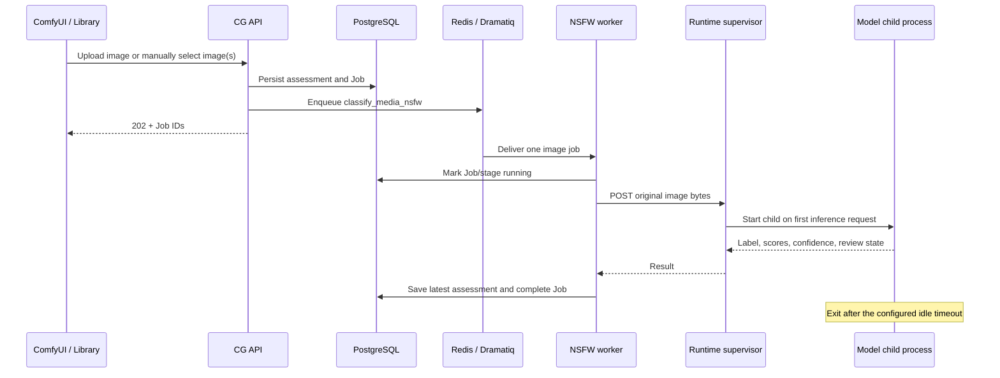

# NSFW Image Classification

**Status:** Mini/PyTorch is the baseline. ONNX and optional NudeNet are
implemented behind explicit runtime settings; parity, accuracy, and NAS
performance acceptance remain pending manual measurements.

## Scope

The first stage runs `viddexa/nsfw-detection-2-mini` against still images. Its
five labels are Normal, Hentai, Porn, Sexy, and Drawing. The model card describes
the model as a screening aid and recommends human review for final decisions.
See the [official model card](https://huggingface.co/viddexa/nsfw-detection-2-mini).

CG stores the model's label and class scores, plus a separate suggested rating:

| Model label | Initial suggestion |
| --- | --- |
| Normal / Safe | Safe |
| Drawing | Safe |
| Sexy | Sexy |
| Porn | Explicit |
| Hentai | Explicit |
| Confidence below 0.70, top-score margin below 0.20, or unknown label | Review |

The confidence and margin values are provisional starting thresholds. They have
not been calibrated against the user's library. Mini does not have a dedicated
Nudity output. When NudeNet is enabled, CG may suggest Nudity from exposed breast,
genitalia, buttocks, or anus detections if Mini is confident and does not return
Porn/Hentai. This is a rule-engine label for exposed-region evidence; it does not
establish nonsexual context. If Mini is uncertain, Review takes priority. The
current release uses NudeNet 320n and records every returned region, score, box,
model revision, and invocation mode.

AI suggestions remain separate from the user's existing `content_rating`. No
classification command changes `sfw` / `nsfw`, hides media, or moves it to Trash.
The current assessment row stores the most recent run, including model revision
and raw scores; each execution also has an ordinary durable `Job` and stage
attempt.

## Request and execution flow



The `worker-nsfw` Dramatiq consumer and `nsfw-runtime` supervisor are small
control-plane processes that stay available with the rest of Compose. The
selected PyTorch or ONNX inference backend, and optional NudeNet session, run in
a child process inside `nsfw-runtime`; that child is started only when a
classification job arrives and is terminated after eight idle minutes by
default. This releases model memory without granting the CG API access to
`/var/run/docker.sock`. The container health check reads `/health` and never
starts the model child.

The service is internal to the Compose network and has no host-published port.
The worker reads the managed original and sends its bytes to the runtime over the
local Compose network. The per-image transfer and extra copy have not yet been
benchmarked; expected model inference time dominates, but NAS measurements must
confirm this.

## Trigger rules

- Both `CG_NSFW_CLASSIFIER_ENABLED` and `CG_NSFW_AUTO_CLASSIFY` default to false.
- When both are true, a completed image upload schedules classification on the
  dedicated `nsfw` queue. Video uploads do not.
- A user may start classification from the Library selection toolbar or the
  Media Detail panel. The selected scope is capped by
  `CG_NSFW_MAX_IMAGES_PER_REQUEST` (2,000 by default). Non-images and media that
  are not ready are skipped.
- Library, detail, and status GET requests never call the inference runtime.
- An active job is reused. A completed result with the configured model ID and
  revision, backend, and NudeNet settings is skipped unless the user explicitly
  chooses “Run again”.

## Runtime configuration

The `nsfw-runtime` image contains CPU-only PyTorch, ONNX Runtime, Transformers,
Pillow, Safetensors, and the pinned NudeNet 320n package model. Model files are
not committed or downloaded during inference. Download Mini to the mounted local
directory before enabling classification:

```bash
uvx --from huggingface_hub hf download \
  viddexa/nsfw-detection-2-mini \
  --local-dir ./models/nsfw/mini
```

Set the model revision to the Hugging Face commit used for that local directory,
then configure:

```dotenv
CG_NSFW_CLASSIFIER_ENABLED=true
CG_NSFW_AUTO_CLASSIFY=false
CG_NSFW_MODEL_REVISION=<hugging-face-commit>
NSFW_INFERENCE_BACKEND=pytorch
NSFW_NUDENET_ENABLED=false
CG_NSFW_REQUEST_TIMEOUT_SECONDS=480
NSFW_IDLE_TIMEOUT_SECONDS=480
NSFW_CPU_THREADS=2
NSFW_REVIEW_CONFIDENCE_THRESHOLD=0.70
NSFW_REVIEW_MARGIN_THRESHOLD=0.20
NSFW_CPU_LIMIT=2.0
NSFW_MEMORY_LIMIT=1536M
```

The runtime defaults to one inference request at a time, two PyTorch threads, a
64 MiB image-body limit, a 240-second cold-start limit, and a 480-second idle
timeout. Images above the configured byte limit are rejected before the worker
loads them into memory. The API-to-runtime request timeout defaults to 480
seconds to cover a cold start plus inference. The container's memory ceiling
applies to both the small supervisor and the model child. These are starting
resource limits, not measured J4125 results.

Before enabling automatic classification for a large library, measure cold-start
time, steady-state P50/P95 latency, idle versus loaded resident memory, and
10-minute sustained CPU/RAM on J4125. Accuracy and Review thresholds need a
separately labeled image corpus and human review.

For the optional ONNX path, export Mini on the Mac/PC with
`bash scripts/export_nsfw_onnx.sh`. The exported `model.onnx` stays in the local
ignored `models/nsfw/mini-onnx` directory. Set
`NSFW_INFERENCE_BACKEND=onnx` only after the parity helper passes on the same
private sample images. The ONNX engine uses FP32 and a CPUExecutionProvider; do
not treat ONNX or INT8 as faster until the NAS comparison says so.

NudeNet is disabled by default. Its all-images mode is the higher-recall option.
`NSFW_NUDENET_RUN_MODE=risk_or_review` saves CPU by skipping Mini-safe/drawing
images, which can miss nonsexual nudity and must be treated as a lower-recall
configuration. The pinned PyPI 3.4.2 package metadata declares MIT, while the
current upstream repository lists AGPL-3.0; check the exact artifact's terms
before redistributing the runtime image. See the [PyPI release metadata](https://pypi.org/project/nudenet/3.4.2/)
and [upstream repository](https://github.com/notAI-tech/NudeNet).

## Manual acceptance sequence

The primary model, accuracy, and J4125 performance checks use the standalone local
benchmark. It reads `testdata/nsfw/samples/` and
`testdata/nsfw/manifest.local.json`; it has no CG API, database, upload, or media
ID dependency. Each phase writes private JSON data and an offline HTML report with
scores, confusion matrix, per-class metrics, image previews, and NudeNet boxes.
See the [Chinese test-set and benchmark guide](../development/nsfw-classification-manual-test-zh.md)
for setup, commands, and resource recording.

Keep test images, the real manifest, JSON results, and HTML reports local. Begin
with a 5–10 image smoke set, expand to 100–200 images for performance comparison,
and use 400–600 reviewed examples for accuracy checks if practical. Keep the
sample mix close to the real library and analyze extra rare-class challenge
samples separately.

The standalone Compose service has no network access and mounts the sample set
read-only. It uses the same `NsfwClassifier` implementation as the on-demand
inference worker, so model post-processing and fusion rules are shared. The
benchmark measures model-load time, direct per-image inference, process RSS, and
container CPU/memory. It does not include CG queue or upload latency.

After standalone results look acceptable, perform one optional CG integration
check: classify one image from its detail page, verify the durable Job and UI
result, and confirm human `content_rating` remains unchanged. Test upload-time
auto-classification with one ComfyUI image only, then turn the toggle back off.
